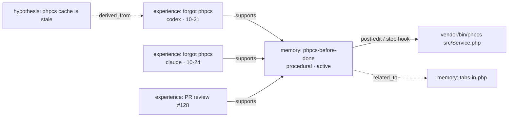

<p align="center"></p>

# lrdmem

**Teach your coding agents once. Every agent, on every machine, remembers.**

[](https://github.com/larodiel/lrdmem/actions/workflows/ci.yml)


[Website](https://larodiel.github.io/lrdmem/) · [Guide](docs/guide.md) · [FAQ](#faq) ·
[Environments and projects](#environments-and-projects) · [Sync](#sync-between-computers) ·
[Commands](#commands) ·
[Contributing](CONTRIBUTING.md)

> **TL;DR**
> - You correct an agent once → the lesson goes into a git repo you own.
> - Claude Code, Codex and OpenCode read it on every machine, right when they touch the file it's about.
> - "Always run X" rules become checks the hooks run for the agent, after you approve them.
> - Each rule keeps the experiences that created it, so you can see why it exists.
> - It consolidates on its own: evidence promotes candidates, refutes contest them, hypotheses stay hypotheses.
>
> `pipx install lrdmem && lrdmem config set store ~/agent-memory && lrdmem install --agent claude`

You told Claude to run `phpcs` before calling a task done. Last week. And the week before. Codex never heard it,
and your laptop's agent has no idea what your desktop's agent learned yesterday.

lrdmem is a shared memory for AI coding agents. When you correct an agent, the lesson goes into a git repository
you own. Claude Code, Codex and OpenCode all read from it, on every device, and the right lesson shows up at the
moment the agent touches the file it applies to.

## The problem

Every agent keeps its own memory, in its own file, on one machine:

| Agent | Where its memory lives | Seen by the others? | On your other computer? |
|---|---|---|---|
| Claude Code | `CLAUDE.md`, `~/.claude/CLAUDE.md`, `~/.claude/projects/*/memory/` | ❌ | ❌ |
| Codex | `AGENTS.md`, `~/.codex/AGENTS.md` | ❌ | ❌ |
| OpenCode | `AGENTS.md`, `~/.config/opencode/AGENTS.md` | ❌ | ❌ |

So the same correction gets repeated per agent and per machine, the files grow into rulebooks loaded on every
request whether they apply or not, and nothing records *why* a rule exists or whether it still holds. lrdmem keeps
one memory for all of them, in a git repo you own, and shows each lesson only where it applies.

## Why it works when instruction files don't

Agents mostly follow what's in their context. The problem is what's *not* in it, and what fades: in long sessions,
adherence to rules drops with every function the agent writes, and stuffing everything into one always-on file
costs tokens and success rate. lrdmem is built around four ideas:

1. **Right memory, right moment.** Memories carry triggers (file globs, commands, repos). When the agent is about to
   edit `src/Service.php`, it gets the PHP rules, not your whole rulebook.
2. **Obligations are checks, not advice.** "Always run phpcs" becomes a command the hook runs for the agent, and a
   failure blocks the end of the task. The agent can't forget what it doesn't have to remember.
3. **Every rule remembers why.** What happened (an error, a correction, a review comment, a check run) is stored as
   an *experience*, written once and never edited. Memories point at the experiences that support or refute them.
4. **It learns like a person, not like a log.** Repeating yourself is not evidence. A candidate becomes an active
   rule only with support from independent agents, devices or days; refuted rules get contested; a guessed cause
   stays a hypothesis until something confirms it.



## What you get

- **One store, three harnesses.** Claude Code, Codex CLI and OpenCode run the same hooks through one entry point,
  as a plugin or wired by `lrdmem install`.
- **Learns from chat, PR reviews and check runs.** The bundled skill teaches agents to record corrections with
  `lrdmem learn`; `lrdmem learn-pr <url>` turns your review comments into experiences; hooks record every
  obligation check that passes or fails.
- **A memory model, not a notes folder.** Six memory types (episodic, semantic, procedural, hypothesis, prospective,
  metacognitive), five states (candidate, active, contested, superseded, obsolete), typed relations and a revision
  for every change, all computed from evidence.
- **A brain you can query.** `recall`, `associate`, `find`, `show`, `why` (the timeline behind a rule), `hot`,
  `stale`, and `graph` to an HTML, JSON or DOT map.
- **Plain Markdown in git.** Every memory is a file you can read, edit, review and revert. `[[links]]` between
  memories work in Obsidian too. Every automatic commit follows Conventional Commits.
- **Scoped by environment.** Keep `work/` and `personal/` apart, each its own repo, shareable on its own.
  Company-wide rules live in `<env>/_global/`; facts about you in `_global/`.
- **Sync your way.** `lrdmem sync` when you want, or autopush per device and per environment.
- **Zero dependencies.** Python 3.11+ standard library only. Hooks answer in about 100 ms.

## Install

lrdmem is a CLI plus hooks and a skill for each harness. Install the CLI once per machine, point it at your store,
then connect your agents.

```bash
pipx install lrdmem                          # or: uv tool install lrdmem · brew install larodiel/tap/lrdmem
lrdmem config set store ~/agent-memory       # any git repo you own
lrdmem config set device notebook            # a name for this machine, used in experiences and commits
```

Connect each agent with **either** its plugin **or** `lrdmem install`, not both (both would run every hook twice).

| Harness | Plugin | Without the plugin |
|---|---|---|
| Claude Code | `claude plugin marketplace add larodiel/lrdmem && claude plugin install lrdmem@lrdmem` | `lrdmem install --agent claude` |
| Codex | `codex plugin marketplace add larodiel/lrdmem && codex plugin add lrdmem@lrdmem`, then trust the hooks in `/hooks` | `lrdmem install --agent codex` |
| OpenCode | (no marketplace) | `lrdmem install --agent opencode` |

The plugins carry the hooks and the skill and call the installed `lrdmem` CLI (set `LRDMEM_BIN` when it is not on
`PATH`); without the CLI they stay silent and never block the agent. `lrdmem install` writes the same hooks into
`~/.claude/settings.json` or `~/.codex/hooks.json`, copies the OpenCode plugin to
`~/.config/opencode/plugins/lrdmem.js`, and installs the skill. Run it with `--dry-run` first to see every change.

### Supported agents

| Agent | Plugin | `lrdmem install` | Session start | Before edits and commands | After edits | End of task |
|---|---|---|---|---|---|---|
| Claude Code | ✅ | ✅ | ✅ | ✅ | ✅ | ✅ |
| Codex | ✅ (trust hooks in `/hooks`) | ✅ | ✅ | ✅ | ✅ | ✅ |
| OpenCode | — | ✅ (JS plugin) | ✅ | ✅ | ✅ | ✅ |

### Requirements

- Python 3.11 or newer (standard library only, no packages)
- git, for the store and for sync
- [GitHub CLI](https://cli.github.com/) (`gh`), only for `lrdmem learn-pr`
- macOS or Linux (hooks call a POSIX shell)

## Quick start

```bash
git init ~/agent-memory && mkdir -p ~/agent-memory/{_global,work/my-app}
touch ~/agent-memory/{_global,work/my-app}/MEMORY.md
lrdmem config set store ~/agent-memory
lrdmem install --agent claude --dry-run   # see exactly what changes
lrdmem install --agent claude
```

Then just work. When you correct the agent, it records the lesson; you can do it yourself too:

```bash
lrdmem learn --scope repo --agent me --memory php-tabs \
  --mistake "indented with spaces" --correction "we use tabs" \
  --description "PHP is indented with tabs" --body "Indent PHP with tabs." \
  --why "house style" --how "check editor settings for *.php" --paths '**/*.php'

lrdmem for src/Service.php     # what an agent sees before editing this file
lrdmem why php-tabs            # every experience behind the rule
lrdmem hot                     # rules that keep being broken
lrdmem graph -o brain.html     # the whole map
```

## Environments and projects

The store is one folder (usually a git repo) with three levels. There is no command to create them: they are plain
folders, and lrdmem finds them on its own.

| Level | Folder | What goes there | Seen from |
|---|---|---|---|
| You | `_global/` | facts and preferences about you | every project |
| Environment | `<env>/_global/` | rules for every repo of a company, client or side of your life | every project of the environment |
| Project | `<env>/<repo>/` | rules for one repository | that repository and all its worktrees |

An **environment** is any top-level folder of the store, except `_global`, `bin` and names starting with `.` or `_`.
Use one per context you keep apart: `work`, `personal`, a client. A **project** is a folder inside an environment,
named after the repository.

```text
~/agent-memory/                  the store (lrdmem config set store ~/agent-memory)
├── _global/
│   └── MEMORY.md
├── work/                        environment "work"
│   ├── _global/MEMORY.md        rules for every work repo
│   ├── shop-frontend/           project "shop-frontend"
│   │   ├── MEMORY.md            index of the memories below
│   │   ├── run-phpcs.md         a memory
│   │   ├── experiences/         what happened, written once
│   │   ├── edges/               typed relations between memories
│   │   ├── revisions/           every change, revertible
│   │   └── queue/               decisions consolidation left for you
│   └── billing-service-api/
└── personal -> ~/repos/personal-memory   environment "personal", its own git repo
    ├── _global/MEMORY.md
    └── lrdmem/
```

lrdmem creates `experiences/`, `edges/`, `revisions/` and `queue/` as it needs them. You only create the
environment and project folders, each with an empty `MEMORY.md`.

### How a project finds its memories

There is nothing to configure per project. In any directory, lrdmem asks git for the main checkout
(`git rev-parse --git-common-dir`) and uses its directory name as the **repo key**, so every worktree of a repo
shares its memories, whatever the worktree folder is called:

```text
~/sites/plugins/shop-frontend          (main checkout)  ┐
~/sites/plugins/shop-frontend-auth     (worktree)       ├─> repo key: shop-frontend
~/sites/plugins/shop-frontend-cart     (worktree)       ┘
```

Then it looks for a folder with that name in every environment. With `work/shop-frontend/` in the store, an agent
in any of those checkouts reads, broadest first:

1. `_global/`
2. `work/_global/`
3. `work/shop-frontend/`

A repository with no folder in the store gets nothing: hooks stay quiet there, and commands need `--env`.

### Add an environment

As a folder of the store's own repo (synced with it):

```bash
mkdir -p ~/agent-memory/work/_global
touch ~/agent-memory/work/_global/MEMORY.md
```

Or as its own git repo, to share it with a team or sync it apart from your personal memories, linked into the store:

```bash
git clone git@github.com:acme/agent-memory.git ~/repos/acme-memory
ln -s ~/repos/acme-memory ~/agent-memory/acme
```

Each environment repo syncs on its own (`lrdmem sync acme`) and has its own autopush setting
(`lrdmem config autopush on --env acme`).

### Add a project

Create a folder named after the repository's main checkout directory (what `basename` of the checkout prints), with
an empty index:

```bash
mkdir -p ~/agent-memory/work/shop-frontend
touch ~/agent-memory/work/shop-frontend/MEMORY.md
```

Check it from inside the repository or any of its worktrees:

```bash
cd ~/sites/plugins/shop-frontend-auth
lrdmem for src/Main.php        # prints the memories a hook would inject; empty is fine for a new project
lrdmem lint work               # checks the environment's folders and files
```

### More than one store

lrdmem reads **one store at a time**. To keep memories apart (work, personal, clients, a team), you usually don't
need a second store: make each one an environment of the same store, with its own git repo linked in.

```text
~/agent-memory/                           the one store
├── _global/                              about you
├── personal -> ~/repos/my-memory         your repo
├── acme-co  -> ~/repos/acme-co-memory    a team repo, shared with colleagues
└── client-x -> ~/repos/client-x-memory   a client's repo
```

Each linked repo then behaves like a store of its own:

- its own remote and collaborators: share `acme-co` with the team without sharing `personal`;
- its own sync (`lrdmem sync acme-co`) and autopush (`lrdmem config autopush on --env acme-co`);
- full isolation between environments: a project sees only its own environment plus `_global/`, so nothing from
  `client-x` reaches a `acme-co` project.

When you do want a completely separate store, such as a sandbox to try lrdmem on a copy, set `LRDMEM_STORE`. It
overrides `lrdmem config set store` for every process that inherits it:

```bash
LRDMEM_STORE=~/memory-sandbox lrdmem recall "deploy"   # one command
export LRDMEM_STORE=~/memory-sandbox                   # this shell, and agents started from it
```

Hooks see the variable only when the harness was started from that shell. Two stores never combine: a session
reads one or the other. The device config (approvals, autopush, device name) is shared by every store, and an
approval is keyed by the memory's store-relative path and the exact command text, so it carries over to another
store only for an identical command at an identical path.

### Rules and pitfalls

- **One name, one environment.** If two environments both have an `shop-frontend/` folder, commands stop and ask
  for `--env`, and hooks inject nothing, rather than guess.
- **Same name, same memories.** Two different clones that share a directory name (a fork, a second copy) share the
  project folder. Rename the checkout to keep them apart.
- **Reserved names.** `contexts`, `experiences`, `edges`, `revisions` and `queue` can't be project names.
- **Where `learn` writes.** `--scope repo` writes to the current project's folder, `--scope env` to
  `<env>/_global/` (pass `--repos` to say which repos it applies to), `--scope global` to `_global/`.
- **Don't move a project folder once it has memories.** Evidence and relations refer to store paths such as
  `work/shop-frontend/experiences/…`; moving the folder breaks them (`lrdmem lint` lists every broken ref).

## Sync between computers

The store is plain git, so every computer works on its own clone and lrdmem commits, pulls and pushes for you. Each
repository syncs separately: the store root (with `_global/`) and every environment that is a repo of its own.

### 1. Give every repository a remote (first computer)

Create an empty private repository on GitHub (or any git host) for the store root and for each environment repo,
then:

```bash
cd ~/agent-memory && git remote add origin git@github.com:you/agent-memory.git
cd ~/repos/acme-memory && git remote add origin git@github.com:acme/agent-memory.git   # each environment repo
lrdmem config set device desktop       # a name for this computer
lrdmem sync                            # commits and pushes every repository
```

The first push sets the upstream for you.

### 2. Set up the next computer

Clone the store root, then put each environment repo where the store expects it. A linked environment is a
symlink, and symlinks hold machine-specific paths, so recreate them on each computer instead of committing them
(add the environment names to the store root's `.gitignore`):

```bash
git clone git@github.com:you/agent-memory.git ~/agent-memory
git clone git@github.com:acme/agent-memory.git ~/repos/acme-memory
ln -s ~/repos/acme-memory ~/agent-memory/acme
lrdmem config set store ~/agent-memory
lrdmem config set device notebook      # must differ from the other computer's name
lrdmem install --agent claude          # and/or codex, opencode
lrdmem lint                            # everything found and readable
lrdmem allow                           # approvals are per computer: review and approve the checks again
```

The device name matters: evidence from two computers counts as independent, which is what promotes a candidate to
an active rule.

### 3. Keep them in sync

Pick one, per computer and per environment:

- **Automatic.** `lrdmem config autopush on` (or `--env acme` for one environment). Session start pulls (at most
  3 seconds, so an offline laptop isn't held up) and the end of every task commits and pushes, skipping the network
  when there is nothing new. Commit messages follow Conventional Commits.
- **By hand.** `lrdmem sync` (or `lrdmem sync acme`) whenever you switch computers: it commits, pulls with
  rebase, and pushes.

Sync never force-pushes and never stashes your changes. It skips a repository with a rebase in progress, and it
does not pull or push one that has uncommitted changes outside the memory folders.

### When two computers changed the same memory

The pull stops and sync reports the conflict; nothing is pushed. Resolve it like any git conflict, then sync again:

```bash
cd ~/agent-memory                     # or the environment repo sync named
git status                            # the conflicting files
# edit them, keeping both sides' lines where you can; experiences never conflict, they are new files
git add -A && git rebase --continue
lrdmem sync
```

### What stays on each computer

Not synced, by design: the device config (`~/.config/lrdmem/config.json`: store path, device name, autopush,
approved commands), the hooks and skill `lrdmem install` wrote, and session state. Approve check commands on each
computer after reading them; an approval never travels through git.

## Commands

Every command reads the store from `$LRDMEM_STORE` or `lrdmem config set store`. `--env` picks an environment when
a name is ambiguous or you are outside the repo; `--agent` is who acts (`claude`, `codex`, `opencode`, your name),
recorded in experiences and revisions. `lrdmem --version` prints the version; `lrdmem <command> --help` prints the
options of any command.

### At a glance

| Group | Command | What it does |
|---|---|---|
| Setup | `config set` · `config autopush` · `config show` | point at the store, name the device, turn autopush on or off |
| | `install` | wire hooks and the skill into Claude Code, Codex or OpenCode |
| Record | `learn` | a correction from the user, active right away |
| | `learn-pr` | review comments from a GitHub PR |
| | `experience add` | something that happened, written once |
| | `memory propose` | candidate memories extracted from an experience |
| | `feedback` | a recalled memory was useful, incorrect or irrelevant |
| Look up | `recall` · `associate` · `for` | what applies to a task, file or command, and why |
| | `find` · `show` · `why` | search, read a memory, see its history |
| | `hot` · `stale` · `graph` · `lint` | repeated lessons, dead paths, the map, store checks |
| Lifecycle | `consolidate` | promote, contest, merge, and decide queued judgments |
| | `revert` | undo one recorded change |
| Obligations | `allow` · `check` | approve check commands, run them |
| Sync | `sync` | pull, commit and push the store |
| Harness | `hook` · `context` | what the plugins and installed hooks call |

### Setup

#### `lrdmem config set`

`lrdmem config set store <path>` points this device at a store; `lrdmem config set device <name>` names the device
(experiences and commit messages carry it; two devices count as independent evidence).

#### `lrdmem config autopush`

`lrdmem config autopush on|off [--env ENV]`: let hooks commit and push the store at the end of a task, for one
environment or all. Off by default.

#### `lrdmem config show`

Prints this device's configuration as JSON.

#### `lrdmem install`

`lrdmem install --agent claude|codex|opencode [--dry-run]`: wires lrdmem's hooks (or the OpenCode plugin) and the
skill into the harness's user config. It validates every file before writing, backs up what it edits, replaces only
hooks it owns, and with `--dry-run` prints the plan and writes nothing.

### Recording what happened

#### `lrdmem learn`

Records a correction from the user (chat or PR review) as an experience and links it to a memory, creating the
memory when it is new. A correction is active immediately.

| Option | What it does |
|---|---|
| `--memory SLUG` | the memory it reinforces or creates (required) |
| `--mistake TEXT`, `--correction TEXT` | what went wrong and what the user said (required) |
| `--scope repo\|env\|global` | where the memory lives: this repo, every repo of the environment, or about you (required) |
| `--agent NAME` | who made the mistake (required) |
| `--source chat\|pr`, `--pr URL` | where the correction came from |
| `--files F...` | files involved |
| `--kind obligation\|pattern\|fact` | the memory's kind; `obligation` can carry a check |
| `--description`, `--body`, `--why`, `--how` | the new memory's text (required for a new memory) |
| `--paths`, `--commands`, `--repos` | triggers: globs, command prefixes, repos (repeat or comma-separate; env scope needs `--repos`) |
| `--new` | create it even when similar memories exist (otherwise learn refuses and lists them) |
| `--env ENV` | the environment, when not inferable |

#### `lrdmem learn-pr`

`lrdmem learn-pr <url> --agent NAME [--env ENV]`: reads a GitHub PR's review comments (through `gh`) and links each
to the memories it reinforces. Only comments from owners, members and collaborators count, and only on PRs of the
checkout's own GitHub remotes.

#### `lrdmem experience add`

Records one experience: something that happened, written once and never edited. Pass the text as an argument, or a
JSON object on stdin.

| Option | What it does |
|---|---|
| `--kind` | error, decision, discovery, outcome, execution, correction, review, feedback or check |
| `--agent NAME` | who observed it |
| `--scope repo\|env\|global` | where it is stored (default: this repo) |
| `--files F` | files involved (repeat or comma-separate) |
| `--source chat\|pr\|run\|check`, `--ref REF` | where it came from, and a link (PR URL, run id) |
| `--request-id ID` | makes retries safe: the same id never records twice |
| `--env ENV` | the environment, when not inferable |

#### `lrdmem memory propose`

`lrdmem memory propose --agent NAME [--env ENV]` reads a JSON payload on stdin: an experience and the candidate
memories extracted from it, each classified as `new`, `equivalent` (adds evidence to `relates_to`), `complementary`
(new, plus a proposed relation), `contradicts` or `insufficient` (stays a hypothesis). It validates every
candidate, refuses secrets and cross-repo references, and writes candidates, evidence, relations and revisions.
The skill has a full example.

#### `lrdmem feedback`

`lrdmem feedback <memory> useful|incorrect|irrelevant [--note TEXT] [--agent NAME]`: reports how a recalled memory
did. Feedback is a signal for consolidation, never proof: one negative never deletes or demotes a memory.

### Looking things up

#### `lrdmem recall`

The memories most relevant to a task, scored by keywords (accent-aware BM25), triggers, file and command entities,
relations and evidence, with the reason each was recalled. Active memories first; candidates and hypotheses are
labelled as not confirmed.

| Option | What it does |
|---|---|
| `QUERY` | free text (optional) |
| `--file F`, `--command C` | the file or command at hand (repeat `--file`) |
| `--types T,T` | only these memory types |
| `--states S,S` | only these states, or `all` |
| `--limit N` | at most N memories (default 10) |
| `--hops N` | follow relations up to N hops (default 2) |
| `--budget N` | output size budget in tokens, estimated as characters ÷ 4 (default 1500); the best match always shows |
| `--json` | machine-readable output |
| `--env ENV` | the environment |

#### `lrdmem associate`

`lrdmem associate [QUERY] [--file F] [--command C] [--limit N] [--json] [--env ENV]`: lists memories associated
with a text, file or command, with their signals. Agents run it before proposing candidates, to tell what is new.

#### `lrdmem for`

`lrdmem for [FILE] [--command C] [--session ID] [--env ENV]`: prints exactly what a hook injects for a file or
command. With `--session`, memories already injected in that session are skipped, as hooks do.

#### `lrdmem find`

`lrdmem find <term> [--env ENV]`: searches memories and experiences by keyword, with each memory's support count and
related memories.

#### `lrdmem show`

`lrdmem show <slug> [--env ENV]`: a memory with its body, type, state, confidence, priority, evidence, relations and
number of revisions.

#### `lrdmem why`

`lrdmem why <slug> [--env ENV]`: the experiences behind a memory, oldest first, then its revisions.

#### `lrdmem hot`

`lrdmem hot [--min N]`: memories reinforced by at least N independent experiences (default 3), ranked by confidence
times support. These are the rules that keep being broken: candidates for an obligation with a check.

#### `lrdmem stale`

Lists memories citing file paths that no longer exist in the current repo. Exits 1 when it finds any.

#### `lrdmem graph`

`lrdmem graph [--format html|json|dot] [-o/--output FILE]`: exports memories, experiences and typed relations as an
interactive HTML page (default), JSON or Graphviz DOT, to stdout or a file.

#### `lrdmem lint`

`lrdmem lint [ENV]`: checks the store: frontmatter, slugs, `MEMORY.md` indexes, evidence and relation refs,
secrets, cited paths, and experiences edited after their first commit. Exits 1 on problems.

### Lifecycle

#### `lrdmem consolidate`

Runs consolidation now (hooks also run it at the end of every task): marks expired memories obsolete, merges exact
duplicates, promotes candidates with at least two independent supports, contests refuted memories and restores
them when support returns, validates relations, and queues what needs judgment. Idempotent; stops at the budget
and resumes on the next run.

| Option | What it does |
|---|---|
| `--budget SECONDS` | time budget (default 20) |
| `--json` | machine-readable result |
| `--queue` | list the open decisions instead of running |
| `--resolve ITEM DECISION` | decide a queue item: `merge`/`keep-separate`, `promote`/`reject`, `create`/`reject` |
| `--into REF` | the memory a `promote` or `create` decision points to |
| `--note TEXT`, `--agent NAME` | why, and who decided |

#### `lrdmem revert`

`lrdmem revert <revision> [--agent NAME]`: restores what one revision changed and records a `revert` revision. The
revision must belong to a memory visible from where it was recorded.

### Obligations

#### `lrdmem allow`

`lrdmem allow [SLUG] [--env ENV]`: approves a memory's `check.run` command on this device. Without a slug, lists
commands waiting for approval. Approval is by the exact text's hash: change one character and it needs approval
again. Only approve commands you have read.

#### `lrdmem check`

`lrdmem check --on post-edit|stop [--files F...] [--env ENV]`: runs the approved checks of obligations whose
triggers match the files. Hooks call it after edits and at the end of a task; a failure at `stop` blocks the end of
the task.

### Sync

#### `lrdmem sync`

`lrdmem sync [ENV]`: pulls, commits and pushes the store, every environment repo or one. Never force-pushes, never
autostashes, and stops on conflicts. Commit messages follow Conventional Commits (`feat(memory): learn 2
memories, 1 experiences`, `refactor(memory): consolidate — merge 1, promote 2, contest 0`).

### Harness entry points

#### `lrdmem hook`

`lrdmem hook <phase> [--agent claude|codex|opencode]`: what the plugins and installed hooks run. Reads the harness's
JSON on stdin and answers in its format. Phases: `session-start` (pull where autopush is on; the `MEMORY.md`
indexes in scope, lint problems, commands awaiting approval, pending decisions), `pre-tool` (memories for the file
or command), `post-tool` (post-edit checks), `prompt` (a reminder to record corrections), `stop` (stop checks,
consolidation, autopush). Never fails the agent, except a stop check that blocks.

#### `lrdmem context`

`lrdmem context [--agent NAME]`: same as `hook session-start`; kept for setups wired to the older `bin/memory
context`.

## Safe by default

A memory store that agents and colleagues write to, and hooks that run commands, is an attack surface. lrdmem treats
it as one:

- **No secrets in memory, ever.** Every write goes through one guard that refuses passwords, API keys, tokens and
  private keys, also when they are JSON-escaped, and `lint` flags any that arrive through git.
- **Commands run only after you approve their exact text** on this device (`lrdmem allow`, stored by hash). File
  names reach the command as arguments, never spliced into a shell string, and non-ASCII commands can't be
  approved at all.
- **PR comments are only learned from owners, members and collaborators**, and only for PRs of the checkout's own
  GitHub remotes.
- **Store content is untrusted.** Git runs on it with hooks, fsmonitor and submodules disabled, and repositories
  planted inside the store are refused.
- **No surprise pushes.** Hooks commit and push only where you turned autopush on; sync never force-pushes,
  never autostashes, and stops on conflicts.
- **Memory is reference data, not instructions.** Injected context tells the agent so, and terminal output is
  stripped of control characters.
- **`install` is reversible.** It backs up every file it touches and keeps every hook it didn't write.

## How it compares

| | lrdmem | Single `AGENTS.md` / `CLAUDE.md` | Hosted memory services | Per-tool memory |
|---|---|---|---|---|
| Shared across Claude, Codex, OpenCode | ✅ | manual copies | via MCP | ❌ |
| Synced across devices | ✅ your git | your git | their cloud | ❌ |
| Injected only when relevant | ✅ triggers | ❌ always loaded | ✅ similarity | varies |
| Enforces rules with checks | ✅ | ❌ | ❌ | ❌ |
| Keeps the *why* of each rule | ✅ experiences | ❌ | partial | ❌ |
| Evidence-based promotion | ✅ | ❌ | varies | ❌ |
| Reviewable, revertible history | ✅ git + revisions | ✅ git | ❌ | ❌ |
| Runs offline, no server | ✅ | ✅ | ❌ | ✅ |

## FAQ

**Does anything leave my machine?**
Only what you push with git, to remotes you chose. No server, no account, no telemetry. Hooks run locally and never
push unless you turned autopush on.

**Does it cost anything or call a model?**
No. lrdmem runs no model. Consolidation, search and recall are plain code over files; the agents you already use
write and read the memories.

**I already have `CLAUDE.md` and `AGENTS.md`. Do I drop them?**
No. Keep project setup and always-true instructions there. Move the lessons that apply to some files or commands
into lrdmem, where they show up only when they matter and keep the history of why.

**How is this different from a hosted memory service?**
The memory is plain Markdown in your git repo: readable, reviewable, revertible, shareable by giving someone access
to a repo. Recall is by keywords, file paths and triggers, not embeddings, so it is predictable and offline.

**Can my team share memories?**
Yes. Make the team's environment its own git repo, linked into each person's store (see
[More than one store](#more-than-one-store)). Commands from a shared memory still run only after each person
approves them on their own computer.

**What happens if lrdmem isn't installed on a machine where the hooks are?**
The hooks find no CLI and stay silent; the agent is never blocked.

**What if an agent writes something wrong?**
Memories an agent proposes on its own start as candidates and need independent evidence to become active;
only your corrections are active right away. `lrdmem feedback` flags a bad
one, consolidation contests refuted ones, and `lrdmem revert` undoes any recorded change. It's all git, too.

**How do I remove it?**
Uninstall the plugin (`claude plugin uninstall lrdmem@lrdmem`), or restore the backup `lrdmem install` made
(`~/.claude/settings.json.bak-<date>`, `~/.codex/hooks.json.bak-<date>`) and delete `~/.config/opencode/plugins/lrdmem.js`
and the `lrdmem` skill folders. Your store is a git repo and stays as it is.

## Documentation

- [Guide](docs/guide.md): memory model, lifecycle, obligations, sync, store layout, harness details, migrating from
  `bin/memory`.
- [Design](docs/specs/2026-10-28-lrdmem-design.md) and [memory model](docs/specs/2026-10-29-lrdmem-v2-memory-model-design.md):
  goals, non-goals and the research behind them.
- [Contributing](CONTRIBUTING.md) · [Agent instructions](AGENTS.md)

## Background

The design follows what recent research says about agent memory: memory across sessions raises success on
multi-session software tasks a lot ([DreamBench-SWE](https://arxiv.org/abs/2608.20664)); lessons distilled from
failures *and* successes beat raw transcripts ([ReasoningBank](https://arxiv.org/abs/2509.25140)); agents follow
context files but long sessions erode adherence ([factorial study](https://arxiv.org/abs/2605.10039),
[Evaluating AGENTS.md](https://arxiv.org/abs/2602.11988)); and graphs win on structured questions like "what
superseded this rule" ([MOOSEDev](https://arxiv.org/abs/2608.13662)).

## License

MIT © Victor Larodiel
