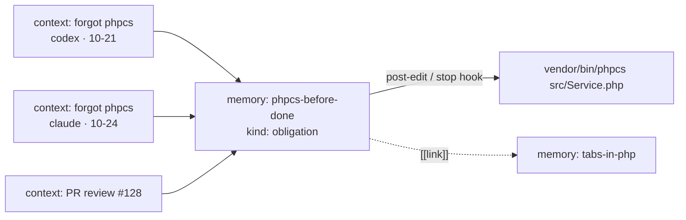

# lrdmem

**Teach your coding agents once. Every agent, on every machine, remembers.**

[](https://github.com/larodiel/lrdmem/actions/workflows/ci.yml)


> **TL;DR**
> - You correct an agent once → the lesson goes into a git repo you own.
> - Claude Code, Codex and OpenCode read it on every machine, right when they touch the file it's about.
> - "Always run X" rules become checks the hooks run for the agent, after you approve them.
> - Each rule keeps the mistakes that created it, so you can see why it exists.
>
> `pipx install lrdmem && lrdmem config set store ~/agent-memory && lrdmem install --agent claude`

You told Claude to run `phpcs` before calling a task done. Last week. And the week before. Codex never heard it,
and your laptop's agent has no idea what your desktop's agent learned yesterday.

lrdmem is a shared memory for AI coding agents. When you correct an agent, the lesson goes into a git repository
you own. Claude Code, Codex and OpenCode all read from it, on every device, and the right lesson shows up at the
moment the agent touches the file it applies to.

```bash
pipx install lrdmem
lrdmem config set store ~/agent-memory      # any git repo you own
lrdmem install --agent claude                # and/or codex, opencode
```

## Why it works when instructions files don't

Agents mostly follow what's in their context. The problem is what's *not* in it, and what fades: in long sessions,
adherence to rules drops with every function the agent writes, and stuffing everything into one always-on file
costs tokens and success rate. lrdmem is built around three ideas:

1. **Right memory, right moment.** Memories carry triggers (file globs, commands, repos). When the agent is about to
   edit `src/Service.php`, it gets the PHP rules, not your whole rulebook.
2. **Obligations are checks, not advice.** "Always run phpcs" becomes a command the hook runs for the agent, and a
   failure blocks the end of the task. The agent can't forget what it doesn't have to remember.
3. **Every rule remembers why.** Each correction is stored as a *context*, a neuron linked to the memory it
   reinforces: what went wrong, what you said, which repo, which agent, when. The rule that keeps coming back
   rises to the top of `lrdmem hot` and becomes a candidate obligation.



## What you get

- **One store, three harnesses.** Claude Code, Codex CLI and OpenCode run the same hooks through one entry point.
- **Learns from chat and from PR reviews.** The bundled skill teaches agents to record corrections with
  `lrdmem learn`; `lrdmem learn-pr <url>` turns your review comments into contexts.
- **A brain you can query.** `find`, `show`, `why` (the timeline of mistakes behind a rule), `hot`, `stale`, and
  `graph` to an HTML, JSON or DOT map of memories and their contexts.
- **Plain Markdown in git.** Every memory is a file you can read, edit, review and revert. `[[links]]` between
  memories work in Obsidian too.
- **Scoped by environment.** Keep `work/` and `personal/` apart, each its own repo, shareable on its own.
  Company-wide rules live in `<env>/_global/`; facts about you in `_global/`.
- **Sync your way.** `lrdmem sync` when you want, or autopush per device and per environment.
- **Zero dependencies.** Python 3.11+ standard library only. Hooks answer in about 100 ms.

## Safe by default

A memory store that agents and colleagues write to, and hooks that run commands, is an attack surface. lrdmem treats
it as one:

- **Commands run only after you approve their exact text** on this device (`lrdmem allow`, stored by hash). Edit one
  character and it needs approval again. File names reach the command as arguments, never spliced into a shell
  string, and non-ASCII commands can't be approved at all.
- **PR comments are only learned from owners, members and collaborators**, and only for PRs of the checkout's own
  GitHub remotes.
- **No secrets in memory.** `learn` and `lint` refuse credential-shaped text.
- **No surprise pushes.** Hooks commit and push only where you turned autopush on; sync never force-pushes,
  never autostashes, and stops on conflicts.
- **Memory is reference data, not instructions.** Injected context tells the agent so, and terminal output is
  stripped of control characters.
- **`install` is reversible.** It backs up every file it touches and keeps every hook it didn't write.

## How it compares

| | lrdmem | Single `AGENTS.md` / `CLAUDE.md` | Hosted memory services | Per-tool memory |
|---|---|---|---|---|
| Shared across Claude, Codex, OpenCode | ✅ | manual copies | via MCP | ❌ |
| Synced across devices | ✅ your git | your git | their cloud | ❌ |
| Injected only when relevant | ✅ triggers | ❌ always loaded | ✅ similarity | varies |
| Enforces rules with checks | ✅ | ❌ | ❌ | ❌ |
| Keeps the *why* of each rule | ✅ contexts | ❌ | partial | ❌ |
| Reviewable, revertible history | ✅ git | ✅ git | ❌ | ❌ |
| Runs offline, no server | ✅ | ✅ | ❌ | ✅ |

## Quick start

```bash
pipx install lrdmem                        # or: uv tool install lrdmem · brew install larodiel/tap/lrdmem

git init ~/agent-memory && mkdir -p ~/agent-memory/{_global,work/my-app}
touch ~/agent-memory/{_global,work/my-app}/MEMORY.md
lrdmem config set store ~/agent-memory

lrdmem install --agent claude --dry-run   # see exactly what changes
lrdmem install --agent claude             # also: --agent codex, --agent opencode
```

A repo takes part when the store has a folder for it (`work/my-app/` above, named after the repo's directory). Then
just work. When you correct the agent, it records the lesson; you can do it yourself too:

```bash
lrdmem learn --scope repo --agent me --memory php-tabs \
  --mistake "indented with spaces" --correction "we use tabs" \
  --description "PHP is indented with tabs" --body "Indent PHP with tabs." \
  --why "house style" --how "check editor settings for *.php" --paths '**/*.php'

lrdmem for src/Service.php     # what an agent sees before editing this file
lrdmem why php-tabs            # every incident behind the rule
lrdmem hot                     # rules that keep being broken
lrdmem graph -o brain.html     # the whole map
```

To enforce a rule, make it an obligation with a `check` and approve it once with `lrdmem allow`. See the
[guide](docs/guide.md#obligations).

## Documentation

- [Guide](docs/guide.md): commands, obligations, sync, store layout, harness details, migrating from `bin/memory`.
- [Design](docs/specs/2026-10-28-lrdmem-design.md): goals, non-goals and the research behind them.
- [Contributing](CONTRIBUTING.md) · [Agent instructions](AGENTS.md)

## Background

The design follows what recent research says about agent memory: memory across sessions raises success on
multi-session software tasks a lot ([DreamBench-SWE](https://arxiv.org/abs/2608.20664)); lessons distilled from
failures *and* successes beat raw transcripts ([ReasoningBank](https://arxiv.org/abs/2509.25140)); agents follow
context files but long sessions erode adherence ([factorial study](https://arxiv.org/abs/2605.10039),
[Evaluating AGENTS.md](https://arxiv.org/abs/2602.11988)); and graphs win on structured questions like "what
superseded this rule" ([MOOSEDev](https://arxiv.org/abs/2608.13662)).

## License

MIT © Victor Larodiel
